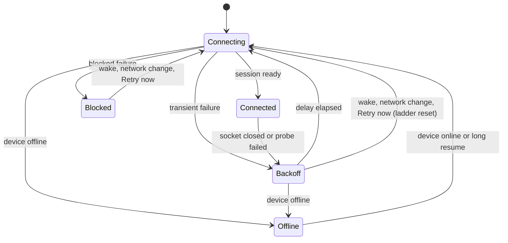

# SSH reconnect

A desktop SSH connection fails for reasons that need opposite responses. A
laptop asleep in a bag needs patience and silence. A rejected key, a changed
host key, or a runtime that refuses this app needs a person, and retrying on a
timer only repeats the same error. This page records how GOAT tells them apart
and how it presents each case. The retry loop itself is the shared
[connection runtime](connection-runtime.md); SSH adds classification and
presentation on top of it, not a second loop.

## States

The [supervisor](../../packages/client-runtime/src/connection/supervisor.ts)
owns one state per environment. SSH connections use the same phases as every
other target. The presentation layer splits `reconnecting` by the last
failure's reason, so the host that is simply away reads differently from the
host that is broken.

| What the user sees                           | Supervisor phase         | Last failure            | Automatic retry                         |
| -------------------------------------------- | ------------------------ | ----------------------- | --------------------------------------- |
| Connected                                    | `connected`              | none                    | —                                       |
| Reconnecting, retrying in 30s                | `connecting` / `backoff` | transient, host reached | backoff                                 |
| Unreachable, retrying in 4m                  | `connecting` / `backoff` | `host-unreachable`      | backoff, quiet                          |
| Offline                                      | `offline`                | any                     | when this device is online              |
| Connection failed: login rejected            | `blocked`                | `authentication`        | on wake, network change, or Retry       |
| Connection failed: host key, runtime refusal | `blocked`                | `configuration`         | on wake, network change, or Retry       |
| Client not supported                         | `blocked`                | `unsupported`           | never; marked unsupported until updated |

Codex's exec-server keeps the same three-way split
([`ConnectionStatus`](https://github.com/openai/codex/blob/816fa702ec66a4c81b204701a03371a1ac3511e6/codex-rs/exec-server/src/client.rs#L309): connected,
recovering, failed). Its app-server reports a disconnected environment without
promising the failure is terminal
([`EnvironmentStatusKind`](https://github.com/openai/codex/blob/816fa702ec66a4c81b204701a03371a1ac3511e6/codex-rs/app-server-protocol/src/protocol/v2/environment.rs#L126)).
GOAT follows that rule: no SSH state other than `unsupported` gives up.

## Classifying a failure

The desktop bridge carries only an error message across IPC, so
[`sshPreparationFailure`](../../packages/client-runtime/src/connection/sshFailure.ts)
reads the sentences `@goat/ssh` writes. A change to those sentences in
`packages/ssh/src/command.ts` or the launch script in
`packages/ssh/src/tunnel.ts` must keep the classifier's patterns matching; the
classifier's tests use the real strings.

- **Unreachable.** ssh exited before it reached the host: connect timeout, no
  route, refused, could not resolve, a banner timeout, or a proxy that closes
  without a more specific diagnostic. `UNKNOWN port 65535` is OpenSSH's proxy
  endpoint placeholder, not a remote port. A slow ProxyCommand or an unresolved
  remote Tailscale name also retries quietly. `describeSshConnectionFailure`
  rewrites connect and banner timeouts as "Cannot reach <alias> over SSH (...)";
  the tunnel step passes ssh's own stderr, which the classifier also reads.
  Generic cloudflared "Not Found", missing-route/peer, or Tailscale keychain
  errors do not establish a broken local executable. With a proxy closure they
  remain unreachable. This is the normal state of a closed laptop or a dropped
  VPN, so it is `host-unreachable`.
- **Local proxy unavailable.** An explicit local Tailscale daemon failure,
  stopped or logged-out client, missing approval, or missing ProxyCommand
  executable is `configuration`, blocked until wake, network change, or Retry.
  Retrying cannot start a local app, sign in, or repair its path; the message
  names that fix and this machine, rather than blaming the remote host. These
  diagnostics take precedence over the generic closure that OpenSSH prints
  afterward. `tailscale nc` writes stopped/login status to stdout, so SSH reads
  it as banner text: commands and tunnel startup retain only those known status
  lines from DEBUG1. Missing executables require a real spawn or shell execution
  diagnostic, not arbitrary "not found" text. The public diagnostic prefers the
  local proxy cause over a subsequent generic closure.

  Commands use `LogLevel=DEBUG1` rather than `-v`, so GOAT does not request
  verbose logging from ProxyJump's child SSH. Lower levels omit the required
  auth milestones and Tailscale banner; `LogVerbose` source/function overrides
  vary by OpenSSH version. The diagnostic stream removes SSH debug output,
  authentication/transfer summaries, version and terminal notices, and login
  URLs while retaining remote stderr, including an unterminated fragment before
  a failed read. Tunnel diagnostics keep their bounded tail.

- **Login rejected.** `Permission denied (publickey…)`, a rejected key-only
  login, and a cancelled password prompt are `authentication`. A locked
  ssh-agent after wake can also stall authentication. An authentication timeout
  is `authentication`, with an instruction to unlock the key or agent. Blocked
  states still retry on wake and network change.
- **Host key.** A changed, unknown under strict checking, or unverifiable host
  key is `configuration`. The fix is to forget the host and review the new
  fingerprint; GOAT never replaces a pinned key automatically.
- **Runtime refusal.** A remote runtime newer than this app, or an incompatible
  one that cannot be replaced, is `configuration`. It is deliberately not
  `unsupported`: that reason switches the environment off in the registry, and
  updating the app or stopping the remote server must bring it back without
  the user finding a disabled switch.
- **Timeout stage.** OpenSSH's connect/banner timeout is `host-unreachable`.
  The command deadline uses DEBUG1's authentication-service and authenticated
  milestones (including a reused control connection) to distinguish an auth
  stall from a remote command stall; a TCP connection alone does not prove
  authentication began. A jump host's login does not authenticate the final
  target: forwarding and a new target-authentication milestone reset the stage.
  Timeout headlines take precedence over incidental stderr warnings in public
  diagnostics and runtime status. After login, command, runtime install/download,
  launch, and pairing deadlines name their operation and remain `remote-unavailable`.
  Local HTTPS/gh archive download deadlines also remain runtime failures, never
  SSH login or host reachability failures. A ready tunnel whose backend does not
  answer remains a runtime failure, except the explicit high-latency readiness
  diagnostic, which is `network`.
- **Everything else** is a transient `remote-unavailable` failure of a host
  that answered: a server that did not start, a tunnel nothing answered on, a
  slow network.

Only ssh's own connection failure counts as unreachable. A tunnel that opened
but whose server never answered means the host is awake and GOAT on it is
broken, which deserves the louder state.

## Backoff

`retryDelayMs` doubles a ceiling from 2 s to 5 minutes and picks a point in
its upper half, so clients that lost the same host do not reconnect together.
The ladder resets once a connection stays up for 30 s. Codex's exec-server uses
the same shape with a 30 s cap and a 120 s stability window
([`reconnect_backoff.rs`](https://github.com/openai/codex/blob/816fa702ec66a4c81b204701a03371a1ac3511e6/codex-rs/exec-server/src/remote/reconnect_backoff.rs#L6)).
GOAT's cap is longer because an SSH attempt spawns a process and can wait 10 s
for `ConnectTimeout`, and a sleeping laptop can stay away for hours. The long
cap never delays a return: every signal that conditions changed skips the wait.

## Resuming

These signals start an attempt at once. All but the return to online also
reset the ladder to its first rung:

- The app returns to the foreground (`application-active`).
- The device moves to another network (`network-changed`), the likely moment a
  host behind a VPN or on home Wi-Fi becomes reachable again.
- The desktop wakes from sleep. A long suspension replaces the session outright
  and closes SSH forwards that stopped answering, because ssh's keepalive needs
  45 s to notice a dead TCP connection.
- The device comes back online from `offline`.
- **Retry now** or **Reconnect**.

A connected session receiving one of these is probed, not replaced, so a
healthy tunnel survives a spurious offline report. A long sleep is the
exception: it replaces the session at once, because the OS may have killed the
socket without reporting it.

## Notifications

GOAT sends no notification when a connection drops or returns, and SSH keeps it
that way: the user closed that laptop and does not need to hear about it.
Agent dispatch to an SSH host is a server-side path with its own failure,
`host_unavailable` (see
[remote dispatch](../../structure/launch-and-remote-dispatch.md)); it does not
use this client state.

## What each surface shows

- **Connections and Fleet** (one shared section): an unreachable host's status
  reads a muted "Unreachable". Reconnecting after the host answered stays in
  the error tone. The full reason is in the status tooltip.
- **Thread view**: the banner above the composer names the host and the
  countdown. For an unreachable host it uses the default tone and says the host
  may be asleep or off the network, without the raw ssh error; otherwise it is a
  warning with the reason. It offers **Retry now** while retrying and
  **Reconnect** when blocked. It waits 2 s before appearing so a brief blip shows
  nothing.
- **Sidebar and provider settings**: an unreachable host's dot is the idle gray,
  with no ping. A continuous animation for a host that is away for hours costs
  GPU time and says nothing.

Codex's app follows the same idea in its remote connection badge: each failure
names one action (Reconnect, Sign in, Update, Restart), and a chat on an
unavailable host reads "Remote host unavailable" with a link to manage the
connection rather than an error.

## In-flight work

Turns run on the remote GOAT server, so a client disconnect does not stop
them. While disconnected, cached threads stay readable, the composer is
disabled, and actions that need the host ask the user to reconnect first. Durable
subscriptions follow the replacement session and replay from their cursor.
Mutations are never replayed automatically; their retry rules belong to the
operation. Codex's exec-server holds process sessions for 30 s on the server
and retries recovery for 25 s on the client
([`client_recovery.rs`](https://github.com/openai/codex/blob/816fa702ec66a4c81b204701a03371a1ac3511e6/codex-rs/exec-server/src/client_recovery.rs#L63)); GOAT does
not need that window because nothing the client owns dies with the socket.
